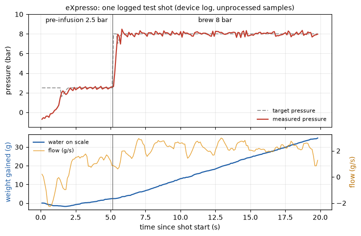
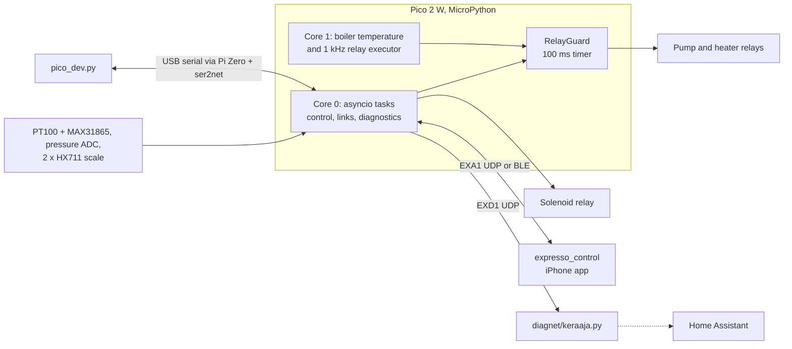

# eXpresso

[](https://github.com/Rolppe/expresso/actions/workflows/ci.yml)

MicroPython firmware that replaces the control electronics of a Rancilio Silvia espresso machine with a Raspberry Pi Pico 2 W, for someone who wants a pressure-profiled,
scale-aware machine they can read, test and extend.

It holds boiler temperature, runs the pump against a pressure or flow target, weighs the drip tray, and talks to a phone app over BLE or Wi-Fi.
Three mains relays are in the firmware's hands, so most of the engineering is about safety, timing and testing on a microcontroller with a garbage collector.
The repository also holds the host tools, the test suite, device logs, and the working notes of the project (in Finnish).

## What it does

- Holds boiler temperature with a PI controller; separate brew, steam and standby targets; standby timers; fast heat-up.
- Runs shots as pre-infusion, brew and soft pressure release against a pressure target, or against a flow target when the drip-tray scale is present.
- Weighs the drip tray with two load cells: weight, flow in g/s, first-drop detection, tray-full tracking, tare and calibration wizards.
- Steam and hot-water modes from the machine's own switches; a backflush cleaning programme when the brew switch is on at power-up.
- Streams live telemetry (5 Hz) to a phone, accepts settings, and delivers a 10 Hz log of every shot to the app ([protocol](docs/PROTOCOL.md)).
- Pressure-sensor calibration wizard, stored on the device.
- Sends all console output and per-shot samples as UDP to a collector (`diagnet/keraaja.py`), which can publish to Home Assistant.
- Switches the heater and pump off whenever a safety limit is crossed, and on every boot, crash or tool operation.

## Visual



*One 20 s test shot (water only, no coffee puck) measured on the real Pico: 2.5 bar pre-infusion, then an 8 bar brew. The figure is drawn by [docs/images/plot_shot.py](docs/images/plot_shot.py) from the unprocessed samples (every 100 ms) in the device log [testit/c1x-20261020-shot1.log](testit/c1x-20261020-shot1.log), captured over USB serial on 20.10.2026. The log has no temperature channel.*



## Engineering highlights

- **Safety limits at the actuator.** A new test command once ran the pump without the tray limit and the tray began to overflow. Now `GuardedRelay` wraps the pump and heater,
  and a 100 ms timer enforces overpressure, run time, temperature, sensor plausibility and a no-rise heater latch even inside loops that never yield.
  A source-level test checks that no code path touches the raw pins. [`pico/relayguard.py`](pico/relayguard.py), [`testit/turva_toimilaite_smoke.py`](testit/turva_toimilaite_smoke.py).
- **Relays off first, a watchdog behind them.** Relays are driven low as the first statement of `boot.py` and `main.py`, and again in a `finally`. An 8 s hardware watchdog catches hangs,
  and every host operation starts with a relay read-back. [`pico/devsafe.py`](pico/devsafe.py), [`pico/boot.py`](pico/boot.py).
- **Mains-phase clock without a zero-cross detector.** The pump's pressure ripple is demodulated (I/Q) and fed to a three-state Kalman filter that tracks phase, period and drift of the grid,
  so individual mains cycles can be gated. Developed in a host simulation first. [`pico/verkkokello.py`](pico/verkkokello.py), [`testit/verkkokello_sim.py`](testit/verkkokello_sim.py).
- **Dual-core real time.** Core 1 reads the boiler sensor in short steps and, during a shot, samples pressure at 1 kHz and switches the pump relay at queued times, with the heap locked
  and no allocation, so core 0's garbage collection cannot delay it. [`pico/classes.py`](pico/classes.py) (`TemperatureSensor`).
- **Controllers.** Pump pressure PI applied as time-proportioned on/off in whole pump-stroke steps, with anti-windup; an outer flow PI; a boiler PI whose
  post-shot heating factor is learned and stored. [`pico/classes.py`](pico/classes.py).
- **Scale signal processing.** Flow is a least-squares slope over a window chosen from measured noise (0.25 g at 11.6 samples/s); the first drop of coffee is found with a CUSUM detector.
  [`pico/scale.py`](pico/scale.py).
- **Authenticated UDP link with a hand-written HMAC-SHA256.** MicroPython has no `hmac`, so it is implemented by hand in a few lines; boot id and sequence numbers give replay protection and
  repeat-safe acknowledgements. [`pico/wifilink.py`](pico/wifilink.py).
- **Diagnostics that cannot block control.** All stdout is teed into a preallocated ring buffer and sent by a task that never waits; interrupt-safe, allocation-free, and drops are counted.
  [`pico/diagnet.py`](pico/diagnet.py). Flashing is atomic too: files go to `<name>.new`, are hashed on the device, and are renamed only when all hashes match. [`pico_dev.py`](pico_dev.py).

## Tech stack

| Layer | Technology | Version |
|---|---|---|
| Microcontroller | Raspberry Pi Pico 2 W (RP2350) | |
| Firmware | MicroPython, `asyncio`, `_thread` (two cores), `machine.Timer`, `hashlib` | v1.28.0 (2026-04-06) |
| Sensors | MAX31865 with PT100 (SPI), pressure transducer (ADC), 2 x HX711 | [HARDWARE.md](docs/HARDWARE.md) |
| Drivers | Adafruit MAX31865 and SPI device (MIT, adapted) | in `pico/lib/` |
| Links | USB-CDC, BLE GATT, UDP over Wi-Fi | [PROTOCOL.md](docs/PROTOCOL.md) |
| Host tools and tests | Python 3, standard library only; macOS or Linux (`fcntl`) | run with 3.15.0; two tests also tried on 3.13 and 3.10 |
| Dev serial link | Raspberry Pi Zero with ser2net (raw TCP, port 2217) | |
| App | Flutter, in a separate repository | [expresso_control](https://github.com/Rolppe/expresso_control) |

## Architecture

The firmware is a set of cooperative `asyncio` tasks on core 0 around one shared state object (`BrewData`), a second program on core 1 for the parts that cannot tolerate a pause,
and a safety layer between the controllers and the relays. USB serial, BLE and Wi-Fi are three front doors to one command dispatcher; the Wi-Fi door accepts a signed subset.
See [ARCHITECTURE.md](ARCHITECTURE.md) for the codemap, the invariants and six design decisions with their reasons.

## Repository layout

```
pico/            firmware copied to the Pico (main.py, boot.py, classes.py, functions.py, relayguard.py, wifilink.py, ...); MANIFEST.json holds a SHA-256 per file
pico_dev.py      host tool: flash, verify, send commands, capture experiment output
diagnet/         UDP diagnostics collector (keraaja.py) and a reference client for the app link
testit/          41 *_smoke.py tests, 37 simulation/analysis/probe scripts, 349 device logs
scale/testit/    scale hardware tests
paketit/         briefs, specs and plans for the agent-built work (Finnish)
docs/            PROTOCOL.md, HARDWARE.md, DEVELOPMENT.md
ohjevahti.py     Claude Code hook that checks device commands against recorded instructions
*.md             REKISTERI, HISTORIA, ARKISTO and other working notes (Finnish)
build_set.py     phone-link set builder (legacy)
oneplus-akkuvahti.*  battery watch for the legacy phone link (legacy)
```

## Getting started

Reading and testing need only Python 3 on macOS or Linux. Running on a machine needs the hardware in [docs/HARDWARE.md](docs/HARDWARE.md), a Pico 2 W that already has
MicroPython v1.28.0 installed (not covered here), and a way to reach its USB serial port. The default path is a Pi Zero running ser2net.

```
cp local.env.example local.env                    # set PICO_ZERO to the host that has the Pico on USB
cp pico/secrets.py.example pico/secrets.py        # Wi-Fi name and password (ignored by git)
python3 pico_dev.py manifest pico/MANIFEST.json   # recompute hashes; the committed manifest holds the author's secrets.py hash
python3 pico_dev.py verify pico/MANIFEST.json     # compare the Pico with the manifest
python3 pico_dev.py flash pico/MANIFEST.json      # write changed files, check SHA-256, reset
python3 pico_dev.py cmd stby?                     # send "CMD stby?" to the running firmware
python3 pico_dev.py safe                          # relays off, read back, reset
```

`python3 pico_dev.py` prints the full usage. `safe`, `verify`, `flash` and `watchdog-test` begin with Ctrl-C and a relay read-back (`devsafe.enter()`).
`cmd`, `capture` and the experiment operations (`shot`, `pcap`, `psweep`, ...) send commands to the running firmware without interrupting it, and rely on its own guards.
Variables are in `local.env.example`; the firmware's diagnostics host is set in `pico/local_config.py` (copy `pico/local_config.py.example`). Addresses in the repository are
RFC 5737 placeholders (`192.0.2.x`). After editing files in `pico/`, run `manifest` again. Do not commit the rewritten `MANIFEST.json`.

## Tests

```
python3 testit/<name>_smoke.py        # prints OK/FAIL lines and a final RESULT line; exit code 0 = pass
```

41 `*_smoke.py` files run the firmware modules on a desktop interpreter with fake clock, pins and sockets. A static count finds about 1,170 `check` calls in them.
Control behaviour is covered by simulations and by device runs that cannot be repeated without the machine: 37 further scripts in `testit/` and 349 captured device logs.
A device log is the evidence for a measurement, for example `testit/rate_probe.out` reports the MicroPython build the numbers came from.

Result of running every smoke test once, 60 s timeout each, on macOS with Python 3.15.0 (29 October 2026): **35 of 41 exited 0.** The other six:

- `tilaus_invariantit_smoke.py`: 27 of 68 checks fail, because it needs a tool from the private monorepo.
- `paine_tasaus_smoke.py`: 10 failures. It looks stale, since `preset.py` now has idle pressure equalisation off. Same result on Python 3.13 and 3.10.
- `wifi_suora_smoke.py`: 1 failure, a check that wants both settings halves in one packet while the firmware sends them as two. Same on 3.13 and 3.10.
- `esiuutto_smoke.py`: does not finish in 60 s. A rerun with a 600 s limit took 299 s and ended with 168 OK and 3 FAIL lines (statistical pressure and clock-lock checks).
- `diagnet_keraaja_smoke.py`: two timing checks failed in the sweep and passed on a rerun by itself.
- `termostaatti_smoke.py`: hit the 60 s limit in the sweep and passed in 20 s by itself.

CI (GitHub Actions, `.github/workflows/ci.yml`) runs the 36 smoke tests that are reliable on a shared Linux runner. It skips the four above that do not pass and also `ystall_smoke.py`: that test checks a real sensor thread right after fixed sleeps. It passes on a desktop, 6 of 6 runs, but on the 2-core CI runner its reading count and hand-back checks race the thread.

Hardware-dependent scripts (`pcap`, `shot_*`, `tray_calib`, `*_probe`, `scale/testit/`) need the machine and a configured `local.env`.

## How it was built

Mikko Paaso set the requirements, designed the architecture and directed the work. Claude Code agents wrote the code from written briefs. A planner session turned a requirement into a plan and a
brief (task, files that may and may not be touched, numbered steps, acceptance commands, a line budget), an executor agent carried it out, and the acceptance commands and hardware runs
decided whether it counted. Mikko reviewed the results and decided what to keep; the original requests are kept verbatim in `KAYTTAJAN-TIEDOT.md`.

- Evidence in the repository: 34 briefs, 24 correction briefs, 11 specs and a dispatch log of 19 executor runs (`paketit/`), the register and history (`REKISTERI.md`, `HISTORIA.md`),
  and 349 logs from runs on the machine.
- Git history: 203 commits between 2026-09-17 and 2026-10-29, 185 with a `Co-Authored-By: Claude ...` trailer.
- `ohjevahti.py` is a Claude Code `PreToolUse` hook written to stop device runs that deviate from the owner's recorded instructions, after an agent session did so seven times.
  It has a smoke test; its instruction book is empty here and it was not installed in the author's settings when last checked.

[docs/DEVELOPMENT.md](docs/DEVELOPMENT.md) describes the workflow, the Finnish working notes and a glossary.

## Status and limitations

- Extracted from a private monorepo. The working notes and briefs refer to paths and tools that are not here, and `testit/tilaus_invariantit_smoke.py` needs a tool from that monorepo and fails.
- The last full smoke run is not all green (see Tests). Part of that is test drift: `paine_tasaus_smoke.py` appears to assume pressure equalisation is on, while `preset.py` has it off.
- `ugit.py`, `api_functions.py` and `boot_bluetooth_test.py` are not used by `main.py`, but are still listed in `MANIFEST.json` and flashed.
- Written for one machine. Calibration values, limits and timing constants come from measurements on it, and there is no schematic or parts list.
- BLE is off by default (`preset.py`) and has no pairing or command allow-list. The Wi-Fi link authenticates commands but does not encrypt telemetry, and its replay protection is per source address.
- Serial `CMD_OK`/`CMD_UNKNOWN` is stale for a few commands that return early (see `docs/PROTOCOL.md`).
- `pico_dev.py` and the test scripts target macOS or Linux (they use `fcntl`). The phone link (`PICO_LINK=phone`, `build_set.py`) is legacy.
- Some code comments are out of date: `classes.py` and `functions.py` say 60 Hz where the mains is 50 Hz, and `verkkokello.py` mentions the RP2040.
- The register of 27.10.2026 lists on-machine verification of pressure equalisation, steam, standby and brew as awaiting the owner.
- `MANIFEST.json` lists an entry for `secrets.py` with the author's hash, so a fresh clone must run `manifest` before `flash`.

## Related repositories

- [expresso_control](https://github.com/Rolppe/expresso_control): the Flutter iPhone app that talks to this firmware over BLE and Wi-Fi. It follows [docs/PROTOCOL.md](docs/PROTOCOL.md).

## License

AGPL-3.0-only, see [LICENSE](LICENSE). Copyright (c) 2026 Mikko Paaso.
